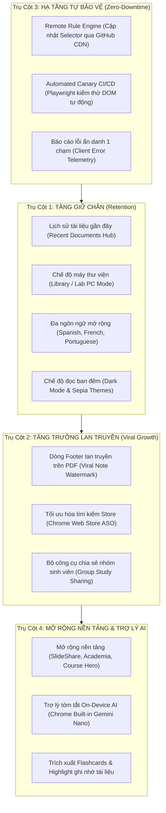

# 🗺️ DocCleaner: Long-Term Product Roadmap & Growth Strategy
### Lộ Trình Phát Triển Dài Hạn · Kiến Trúc Giữ Chân Người Dùng · Hệ Sinh Thái Học Tập Thông Minh

> **Tài liệu chiến lược:** Dành cho đội ngũ phát triển DocCleaner & KapKap Studio  
> **Cập nhật lần cuối:** 2026-11-20  
> **Phiên bản hiện tại:** `v1.8.0`  
> **Mục tiêu quy mô:** Từ **~600 users** hiện tại ➔ **5.000 users** (6 tháng) ➔ **25.000+ Active Students** (12–18 tháng)  

---

## 1. 🎯 Tầm Nhìn & Định Vị Chiến Lược (Strategic Vision)

### 1.1. Chuyển dịch mô hình sản phẩm (The Core Pivot)
DocCleaner không chỉ dừng lại ở một **"tiện ích dọn quảng cáo và in ấn tạm bợ" (Disposable Single-Use Utility)**, mà sẽ chuyển dịch thành **"Trạm làm việc & Đọc tài liệu học tập hàng ngày" (Daily Focused Study Hub & AI Companion)** cho sinh viên đại học trên toàn cầu.

```
                              QUÁ TRÌNH CHUYỂN DỊCH VỊ THẾ
                              
   [ Hiện tại: v1.0 - v1.8 ]                            [ Tương lai: v2.0 - v3.0 ]
   "Single-Use Print Fixer"                            "Personal Daily Study Hub"
┌──────────────────────────────┐                    ┌──────────────────────────────┐
│ • Cài để in 1 tài liệu       │                    │ • Mở hàng ngày để đọc & ôn   │
│ • Gỡ sau khi tải xong        │   CHUYỂN DỊCH      │ • Lưu thư viện tài liệu gần  │
│ • Chỉ hỗ trợ Studocu/Scribd  │ ═════════════════> │ • Tóm tắt bài giảng bằng AI  │
│ • Thụ động chờ Store review  │                    │ • Hỗ trợ SlideShare, Academia│
│ • Tỷ lệ giữ chân 30 ngày: 10%│                    │ • Tự cập nhật luật qua CDN   │
└──────────────────────────────┘                    │ • Tỷ lệ giữ chân 30 ngày: >45%│
                                                    └──────────────────────────────┘
```

### 1.2. Các chỉ số Bắc Đẩu (North Star Metrics)
1. **Weekly Active Students (WAS)**: Số sinh viên kích hoạt tiện ích ít nhất 2 lần/tuần (Mục tiêu: >3.000 WAU).
2. **30-Day Retention Rate**: Tỷ lệ giữ chân sau 30 ngày tăng từ **~10% lên >45%**.
3. **Viral Coefficient ($K$-Factor)**: Hệ số lan truyền tự nhiên đạt **$K \ge 0.35$** (cứ 100 người dùng mang lại 35 người dùng mới qua bản in/chia sẻ ghi chú).
4. **Zero-Downtime Reliability**: Thời gian khắc phục khi web nguồn đổi giao diện giảm từ **3–7 ngày (chờ Store duyệt) xuống <10 phút (qua CDN)**.

---

## 2. 🏛️ Bốn Trụ Cột Chiến Lược Phát Triển Dài Hạn



---

## 3. 🔍 Chi Tiết Kế Hoạch Từng Trụ Cột

### Trụ Cột 1: Tăng Cường Trải Nghiệm & Giữ Chân Người Dùng (Retention Engine)

#### 1.1. Lịch sử tài liệu thông minh & Thư viện cá nhân (Recent & Starred Hub)
* **Vấn đề giải quyết**: 15.91% phản hồi gỡ cài đặt với lý do *"chỉ cần dùng cho 1 tài liệu rồi xóa"*.
* **Giải pháp kỹ thuật**:
  - Tích hợp tab **"Tài liệu gần đây" (Recent Documents)** ngay trong `popup.html`.
  - Lưu trữ tối đa 30 tài liệu gần nhất vào `chrome.storage.local` (Tiêu đề, favicon, nền tảng, số trang, ngày xem, URL gốc).
  - Nút **"1-Click mở lại"**: Nhấp chuột là mở trực tiếp vào Reader Mode đã dọn sạch, không cần vào lại trang gốc chờ tải quảng cáo.
  - Tính năng **Đánh dấu sao (Starred / Favorites)**: Ghim các tài liệu bài giảng quan trọng trong kỳ thi.

#### 1.2. Chế độ máy thư viện / Máy công cộng (Library & Shared PC Mode)
* **Vấn đề giải quyết**: ~10% sinh viên sử dụng máy tính phòng lab trường, thư viện và phải gỡ extension sau khi in xong vì sợ lưu lại lịch sử hoặc tài khoản.
* **Giải pháp kỹ thuật**:
  - Toggle trong popup: **"Chế độ phòng máy / Thư viện"**.
  - Tính năng **"Tải & Tự hủy dữ liệu" (Clean & Burn)**: Sau khi bấm in hoặc đóng tab, toàn bộ cookie phiên, dữ liệu lưu tạm tự động được dọn dẹp sạch sẽ 100%, tạo sự an tâm tuyệt đối khi học ở nơi công cộng.

#### 1.3. Đa ngôn ngữ mở rộng (Extended Internationalization - i18n)
* **Cơ sở dữ liệu**: 78% lượng truy cập đến từ thị trường quốc tế (Mexico, Tây Ban Nha, Pháp, Colombia, Mỹ).
* **Lộ trình ngôn ngữ**:
  - **Giai đoạn 1**: Tiếng Anh (`en`) & Tiếng Việt (`vi`) — *Đã hoàn thành ở v1.8*.
  - **Giai đoạn 2**: Tiếng Tây Ban Nha (`es`) — Thị trường Studocu lớn thứ 2 toàn cầu.
  - **Giai đoạn 3**: Tiếng Pháp (`fr`) & Tiếng Bồ Đào Nha (`pt-BR`).
  - Toàn bộ Popup, Reader Bar, Welcome Tour và thông báo Toast đều tự động nhận diện theo `navigator.language`.

#### 1.4. Chế độ đọc ban đêm & Giao diện bảo vệ mắt (Dark Mode & Sepia Theme)
* **Bối cảnh**: Sinh viên thường ôn thi ban đêm; màn hình tài liệu trắng sáng chói gây mỏi mắt sau 30 phút.
* **Giải pháp**:
  - Bổ sung nút chuyển đổi màu giấy trên Reader Bar:
    - ⚪ **Trắng A4** (Mặc định cho in ấn).
    - 🟡 **Giấy vàng Sepia** (Đọc tài liệu ban ngày dịu mắt).
    - 🌑 **Đêm Deep Navy / Dark Mode** (Đọc ban đêm, đảo màu văn bản thông minh mà không làm biến dạng hình vẽ/sơ đồ).

---

### Trụ Cột 2: Cơ Chế Tăng Trưởng Lan Truyền Tự Nhiên (Product-Led Growth Loops)

#### 2.1. Dòng Footer lan truyền trên bản in PDF (Viral Note Watermark)
* **Nguyên lý tăng trưởng**: Sinh viên in tài liệu ra giấy hoặc xuất file PDF sạch gửi vào nhóm Zalo, Messenger, Discord học tập. Bạn bè trong lớp sẽ nhìn thấy nguồn tài liệu chuẩn đẹp.
* **Thiết kế vi mô**:
  - Ở lề dưới (footer) trang cuối cùng (hoặc rất nhỏ ở lề trang A4):
    ```
    📄 Cleaned & formatted with DocCleaner (Free Studocu & Scribd Reader) · bit.ly/doccleaner
    ```
  - Thiết kế tinh tế, chữ xám nhạt `10px`, không làm mất thẩm mỹ tài liệu.
  - Cho phép người dùng tùy chọn bật/tắt trong cài đặt popup (tôn trọng quyền riêng tư).

#### 2.2. Tối ưu hóa SEO trên Chrome Web Store (ASO - App Store Optimization)
* **Từ khóa ngách có nhu cầu tìm kiếm khổng lồ**:
  - `studocu downloader`, `studocu clean print`, `scribd unblur free`, `studocu pdf export`, `distraction-free reader mode`.
* **Kế hoạch tài sản truyền thông**:
  - Viết lại phần mô tả Store bằng 3 thứ tiếng: Tiếng Anh, Tiếng Tây Ban Nha, Tiếng Việt.
  - Cập nhật bộ 5 ảnh chụp màn hình chuẩn tỉ lệ **1280 × 800**:
    1. So sánh trực quan Trước & Sau (Before vs After).
    2. Thanh Reader Bar với đếm trang thông minh.
    3. Hộp thoại in chuẩn khổ A4 không trang trắng xen kẽ.
    4. Không cần đăng nhập tài khoản — 100% Riêng tư & Miễn phí.
    5. Đánh giá 5 sao từ cộng đồng sinh viên quốc tế.

#### 2.3. Tiếp cận cộng đồng sinh viên đại học (Targeted Seeding)
* Chia sẻ giải pháp vào các hội nhóm sinh viên các khối ngành có tài liệu dài:
  - Sinh viên Y Dược (tài liệu giải phẫu, bệnh học 80–150 trang).
  - Sinh viên Luật (giáo trình văn bản quy phạm pháp luật).
  - Sinh viên Kinh tế / Tài chính (slide bài giảng CFA, bài tập nguyên lý kế toán).
* Không quảng cáo phản cảm; tập trung chia sẻ mẹo: *"Cách đọc và in tài liệu Studocu không bị giật lag máy và không bị trang trắng xen kẽ"*.

---

### Trụ Cột 3: Hạ Tầng Bền Vững & Tự Phục Hồi (Zero-Downtime Reliability)

#### 3.1. Cơ chế cập nhật bộ lọc từ xa (Remote Dynamic Rule Engine via GitHub CDN)
> [!IMPORTANT]
> **Rủi ro chí tử:** Studocu và Scribd đổi cấu trúc class HTML định kỳ 1–2 tháng/lần. Nếu phải viết code, đóng gói và nộp lên Chrome Web Store thì phải chờ **2 đến 7 ngày duyệt**. Trong thời gian đó, 100% người dùng gặp lỗi và sẽ đánh giá 1 sao hoặc gỡ tiện ích.

* **Kiến trúc giải pháp**:
  ```
  ┌────────────────────────────────────────────────────────┐
  │ GitHub Repo (DocCleaner) / Branch: rules / rules.json  │
  └───────────────────────────┬────────────────────────────┘
                              │ Push commit khi web đổi class
                              ▼
  ┌────────────────────────────────────────────────────────┐
  │ jsDelivr CDN / raw.githubusercontent.com (Global Cache)│
  └───────────────────────────┬────────────────────────────┘
                              │ Cache ETag check mỗi 6–12 giờ
                              ▼
  ┌────────────────────────────────────────────────────────┐
  │ Background Service Worker (background.js)              │
  │ Lưu cấu hình vào chrome.storage.local                  │
  └───────────────────────────┬────────────────────────────┘
                              │ Inject selector động vào DOM
                              ▼
  ┌────────────────────────────────────────────────────────┐
  │ Content Script (content.js & scribd_handler.js)        │
  │ Dọn dẹp chính xác theo selector mới nhất               │
  └────────────────────────────────────────────────────────┘
  ```
* **Lợi ích**: Khi Studocu đổi class, bạn chỉ cần sửa 1 dòng JSON trên GitHub trong **2 phút**. Hàng ngàn người dùng sẽ nhận được luật mới ngay lập tức mà không cần chờ duyệt extension!

#### 3.2. Kiểm thử tự động hồi quy DOM (Automated Canary CI/CD via Playwright)
* Thiết lập GitHub Actions chạy định kỳ 24 giờ/lần:
  - Tự động mở các link tài liệu mẫu thực tế của Studocu và Scribd bằng Chromium không đầu (Headless Chromium).
  - Kiểm tra xem các selector xóa banner, nút in, và thanh Reader Bar có tìm thấy phần tử tương ứng hay không.
  - Nếu tỷ lệ tìm thấy phần tử < 80% ➔ Tự động bắn thông báo khẩn qua Telegram Bot / Discord Webhook để nhà phát triển biết trước khi người dùng báo lỗi.

---

### Trụ Cột 4: Mở Rộng Hệ Sinh Thái & Trợ Lý Học Tập AI (Ecosystem & AI Assistant)

#### 4.1. Mở rộng hỗ trợ các nền tảng tài liệu học tập khác
Sau khi ổn định Studocu và Scribd, mở rộng thuật toán dọn trang sang:
1. **SlideShare (`slideshare.net`)**: Nền tảng chia sẻ slide bài giảng thuyết trình lớn nhất của LinkedIn.
2. **Academia.edu**: Kho tài liệu nghiên cứu khoa học, luận văn sinh viên.
3. **Course Hero (`coursehero.com`)**: Nền tảng ôn thi đại học toàn cầu.

#### 4.2. Tích hợp tóm tắt On-Device AI (Chrome Built-in Gemini Nano)
* **Ý tưởng**: Sinh viên mở tài liệu ôn thi 40–60 trang nhưng chỉ có 15 phút trước giờ vào phòng thi.
* **Giải pháp đột phá**:
  - Tận dụng công nghệ **Chrome Built-in AI (Prompt API / Summarization API)** chạy trực tiếp trên GPU máy tính người dùng (On-Device):
  - **Zero Server Cost**: Không tốn chi phí thuê server API OpenAI/Anthropic.
  - **Bảo mật 100%**: Nội dung tài liệu không bao giờ rời khỏi máy của sinh viên.
  - Nút **"Tóm tắt 10 ý chính" (Key Takeaways Summary)** hiển thị ngay trên thanh Reader Bar.

#### 4.3. Đánh dấu văn bản (Highlight) & Ghi chú nhanh (Quick Notes)
* Cho phép sinh viên bôi vàng các đoạn văn bản quan trọng ngay trong chế độ Reader Mode.
* Lưu các đoạn highlight vào bộ nhớ máy, xuất kèm khi in ấn thành dạng tóm tắt ghi chú.

---

## 4. 📅 Lộ Trình Triển Khai Chi Tiết Theo Từng Giai Đoạn

| Giai đoạn | Thời gian | Mục tiêu trọng tâm | Tính năng bàn giao | Chỉ số đo lường (KPI) |
|---|---|---|---|---|
| **Phase 1** *(Đã xong)* | Tháng 11/2026 | Ổn định in ấn & Sửa lỗi chết người | • Khử race condition 2.5s<br>• Cân chỉnh A4 toán học<br>• Tối ưu RAM <80MB qua Blob<br>• Reader Bar cố định | Chấm dứt 100% lỗi trang trắng & đơ máy; release v1.6 & v1.7. |
| **Phase 2** *(Hiện tại)* | Cuối Tháng 11/2026 | Giảm Day-0 Churn & Tăng gắn kết | • Day-0 Onboarding Tour phẳng (v1.8)<br>• FAB Pulse & Tooltip<br>• Lịch sử tài liệu gần đây (Recent Docs)<br>• Lab PC Mode | Giảm Day-0 churn từ 88% xuống <35%. |
| **Phase 3** | Tháng 12/2026 | Lan truyền & Bảo vệ hệ thống | • Footer lan truyền trên PDF in<br>• Remote Rule Update qua GitHub CDN<br>• Hỗ trợ Tiếng Tây Ban Nha (`es`)<br>• Tối ưu ASO Chrome Web Store | Tăng trưởng đạt 1.500 active users; Zero-downtime khi web nguồn update. |
| **Phase 4** | Q1/2027 | Mở rộng nền tảng & Đọc ban đêm | • Hỗ trợ SlideShare & Academia.edu<br>• Giao diện đọc ban đêm (Dark Mode/Sepia)<br>• Tự động kiểm thử DOM Canary (Playwright) | Đạt mốc 5.000 active users; mở rộng thêm 2 nền tảng mới. |
| **Phase 5** | Q2–Q3/2027 | Trợ lý học tập thông minh AI | • Tóm tắt tài liệu bằng Gemini Nano cục bộ<br>• Highlight & Flashcard ghi nhớ ôn thi<br>• Đồng bộ tùy chọn cá nhân | Trở thành top 3 tiện ích học tập hàng đầu cho sinh viên quốc tế. |

---

## 5. 💡 Mô Hình Bền Vững & Duy Trì Dự Án (Sustainability)

1. **Cam kết Miễn phí Cốt lõi (100% Free Core Forever)**:
   - Các tính năng dọn quảng cáo, chế độ đọc Reader Mode và in ấn A4 luôn luôn miễn phí, không bao giờ thu phí hay giới hạn số lần in. Đây là cam kết đạo đức giúp sản phẩm được yêu mến.
2. **Ủng hộ tự nguyện (Community Patronage / Buy Me A Coffee)**:
   - Duy trì nút Buy Me A Coffee trong popup và trang cảm ơn. Khi sản phẩm cứu nguy cho sinh viên trong mùa thi, tỷ lệ ủng hộ tự nguyện rất cao.
3. **DocCleaner Supporter Club (Tùy chọn)**:
   - Dành cho sinh viên muốn đóng góp duy trì dự án, đổi lại các huy hiệu Supporter và tính năng nâng cao tùy biến giao diện.

---

> [!TIP]
> **Khuyến nghị ưu tiên trước mắt (Quick Wins cho tuần tới):**
> 1. Triển khai tính năng **Lịch sử tài liệu gần đây (Recent Documents)** trong `popup.html` để biến tiện ích thành thói quen hàng ngày.
> 2. Đặt **Footer lan truyền tinh tế trên bản in PDF** để kích hoạt vòng lặp tăng trưởng tự nhiên giữa các sinh viên cùng lớp.
