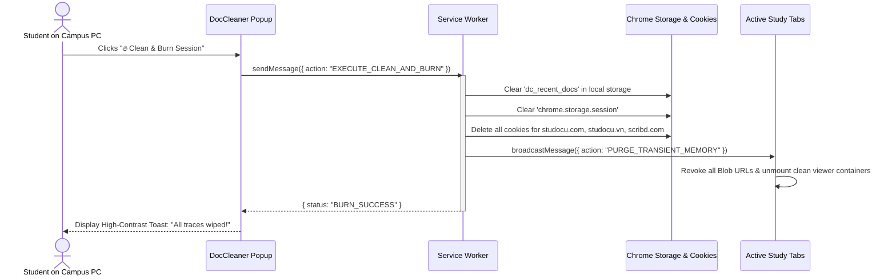
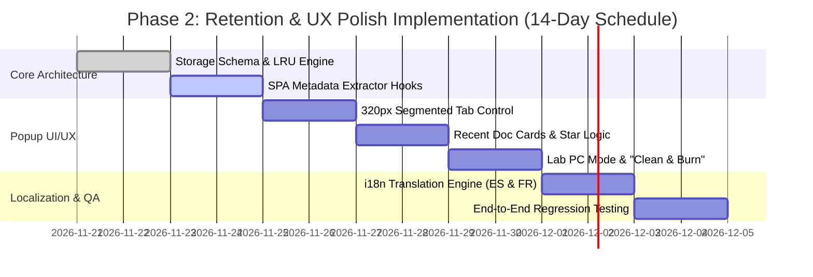

# 📘 DocCleaner: Phase 2 Implementation Plan — Retention & UX Polish
### Solving Single-Use Churn, Curing the Day-0 Cliff & Transforming DocCleaner into a Daily Study Companion

> **Document Version:** `v1.0.0-PROD`  
> **Status:** Production-Grade Implementation Blueprint  
> **Target Release:** DocCleaner `v1.7.0`  
> **Owner:** `@strategist` (DocCleaner Swarm)  
> **Co-Authors & Contributors:** `@auditor` (Technical Architecture), `@analyst` (UX & Retention Analytics), `@coordinator`  
> **Input Artifacts:** User Analytics ($N=221$ uninstalls, $N=44$ survey submissions) & Technical Codebase Audit

---

## 1. Executive Summary & The Retention Thesis

### 1.1 The Churn Problem (The Leaky Bucket)
DocCleaner currently reaches **~600 active weekly users** and attracts **~20 new installs daily**. However, telemetry and user survey analysis conducted in Phase 1 revealed an acute retention vulnerability:
- **The Day-0 Cliff:** **88.69% of all uninstalls (196/221)** occur on the exact calendar day of installation.
- **The Disposable Single-Use Hurdle:** **15.91% of churners** explicitly cited: *"I only needed it once for a specific document"*, while an additional cohort explained: *"I'm removing because this is not my personal use pc"* (campus/library public lab computers).

```
                      [ New Installs: ~20/day ]
                                  │
                  ┌───────────────┴───────────────┐
                  ▼                               ▼
    [ First-Mile Failure (40.9%) ]     [ Single-Use Success (15.9%) ]
         (Clipped / Blank Print)            ("Got my PDF, now delete")
                  │                               │
                  ▼                               ▼
    [ Instant Churn (Day 0) ]          [ Disposable Churn (Day 0-3) ]
```

### 1.2 The Phase 2 Strategic Mission
Phase 1 (v1.6 Hotfix) stabilized core formatting, eliminated the 2.5s print race condition, and slashed memory usage from 1.5GB to <80MB.  
**Phase 2 must solve the user perception and lifecycle problem:** transforming DocCleaner from a *disposable single-click scraping utility* into an *indispensable daily academic binder and personal study companion*.

### 1.3 The 3-Stage Retention Flywheel
```
┌─────────────────────────────────────────────────────────────────────────────┐
│ 1. Day 0: Instant Gratification & Silent Auto-Save                          │
│    User cleans/prints a document -> Instant visual toast:                   │
│    "📚 Saved to your Study Shelf" -> Establishes ongoing perceived value.   │
├─────────────────────────────────────────────────────────────────────────────┤
│ 2. Day 1–3: The Quick-Return Study Loop                                     │
│    Student opens browser for homework -> Extension popup shows yesterday's │
│    document at top of shelf -> 1-click re-open in Clean Reader.             │
├─────────────────────────────────────────────────────────────────────────────┤
│ 3. Day 7–30: The Curated Semester Binder                                    │
│    Student stars (⭐) key formula sheets, syllabus, and lecture decks ->    │
│    DocCleaner becomes their permanent bookmark manager for study platforms. │
└─────────────────────────────────────────────────────────────────────────────┘
```

---

## 2. Technical Architecture & Data Model

### 2.1 Storage Schema (`chrome.storage.local`)
To guarantee instant popup load times (<30ms) without hitting quota limits, document history is stored under key `dc_recent_docs` as an array capped at **25 items** using a strict **Least Recently Used (LRU)** eviction policy with star protection.

```typescript
interface DocCleanerDocument {
  id: string;             // Deterministic hash slug (e.g. "std_18928374" or "scb_99182736")
  title: string;          // Extracted document title (sanitized, trimmed, max 120 chars)
  canonicalUrl: string;   // Clean document URL (no tracking params, session hashes, or anchors)
  platform: 'studocu' | 'scribd'; // Target platform identifier
  pageCount: number;      // Total document pages (0 if pending)
  lastOpenedAt: number;   // Epoch timestamp of last access (Date.now())
  isStarred: boolean;     // Pin flag (pinned docs are immune to standard LRU eviction)
}

interface DocCleanerStorageSchema {
  dc_recent_docs: DocCleanerDocument[]; // Max 25 entries
  dc_lab_mode: boolean;                // Ephemeral Public Lab PC mode (default: false)
  lang: 'en' | 'vi' | 'es' | 'fr';     // User selected locale (default: 'en')
  installedAt: number;                 // Install timestamp
}
```

### 2.2 LRU Eviction & Star-Protection Algorithm
```javascript
/**
 * Inserts or updates a document in the Recent Documents LRU cache.
 * @param {DocCleanerDocument} newDoc
 */
async function recordRecentDocument(newDoc) {
  const { dc_recent_docs = [], dc_lab_mode = false } = 
    await chrome.storage.local.get(['dc_recent_docs', 'dc_lab_mode']);

  // If Lab Mode is active, write exclusively to session storage (auto-purged on exit)
  if (dc_lab_mode) {
    if (chrome.storage.session) {
      const { session_docs = [] } = await chrome.storage.session.get('session_docs');
      const filtered = session_docs.filter(d => d.id !== newDoc.id);
      await chrome.storage.session.set({ session_docs: [newDoc, ...filtered].slice(0, 15) });
    }
    return;
  }

  let docs = [...dc_recent_docs];
  const existingIdx = docs.findIndex(d => d.id === newDoc.id);

  if (existingIdx !== -1) {
    // Preserve existing starred status while updating timestamp and metadata
    const existing = docs[existingIdx];
    docs.splice(existingIdx, 1);
    docs.unshift({
      ...existing,
      title: newDoc.title || existing.title,
      pageCount: newDoc.pageCount || existing.pageCount,
      lastOpenedAt: Date.now()
    });
  } else {
    // New document insertion
    docs.unshift({
      ...newDoc,
      lastOpenedAt: Date.now(),
      isStarred: false
    });

    // Enforce 25-item LRU capacity
    if (docs.length > 25) {
      // Find oldest unstarred document to evict
      let evictIdx = -1;
      let oldestTime = Infinity;

      for (let i = docs.length - 1; i >= 0; i--) {
        if (!docs[i].isStarred && docs[i].lastOpenedAt < oldestTime) {
          oldestTime = docs[i].lastOpenedAt;
          evictIdx = i;
        }
      }

      // If all documents are starred, evict oldest document regardless
      if (evictIdx === -1) {
        evictIdx = docs.length - 1;
      }

      docs.splice(evictIdx, 1);
    }
  }

  await chrome.storage.local.set({ dc_recent_docs: docs });
}
```
* **Storage Footprint Analysis:** 25 items × ~250 bytes = **~6.25 KB**. Negligible overhead against Chrome's 10MB local storage quota.

---

### 2.3 Non-Blocking SPA Metadata Extraction
Both Studocu and Scribd are dynamic Single Page Applications (Next.js & React). Scraping metadata must occur asynchronously without injecting overhead into the rendering thread.

#### Extraction Pipeline (`content.js` & `scribd_handler.js`):
```javascript
function extractPageMetadata(platform) {
  const canonicalUrl = window.location.origin + window.location.pathname;
  let title = '';
  let pageCount = 0;

  if (platform === 'studocu') {
    title = document.querySelector('h1[data-qa="document-title"]')?.innerText
      || document.querySelector('meta[property="og:title"]')?.content
      || (() => {
        try {
          const el = document.getElementById('__NEXT_DATA__');
          return el ? JSON.parse(el.textContent)?.props?.pageProps?.document?.title : '';
        } catch (e) { return ''; }
      })()
      || document.title.replace(/\s*-\s*Studocu.*$/i, '').trim();

    pageCount = document.querySelectorAll('.pf, div[data-page-index]').length
      || parseInt(document.querySelector('meta[name="doc:page_count"]')?.content, 10)
      || 0;
  } else if (platform === 'scribd') {
    title = document.querySelector('.document_title, [class*="DocumentTitle"]')?.innerText
      || document.querySelector('meta[property="og:title"]')?.content
      || document.querySelector('h1')?.innerText
      || document.title.replace(/\s*\|\s*Scribd.*$/i, '').trim();

    const countMatch = document.querySelector('.page_counter, [class*="page_counter"]')?.innerText?.match(/of\s+(\d+)/i);
    pageCount = countMatch ? parseInt(countMatch[1], 10) : document.querySelectorAll('.outer_page, .document_page').length;
  }

  // Generate a collision-resistant deterministic ID
  const hash = Math.abs(canonicalUrl.split('').reduce((acc, char) => ((acc << 5) - acc) + char.charCodeAt(0), 0));
  const id = `${platform.slice(0, 3)}_${hash.toString(16)}`;

  return {
    id,
    title: sanitizeTitle(title) || 'Untitled Document',
    canonicalUrl,
    platform,
    pageCount: pageCount || 0
  };
}
```

#### SPA Route Change Observer (Zero Polling):
```javascript
function observeSpaNavigation(callback) {
  let lastUrl = location.href;
  const notifyIfChanged = () => {
    const currentUrl = location.href;
    if (currentUrl !== lastUrl) {
      lastUrl = currentUrl;
      // Debounce 400ms for React hydration
      setTimeout(callback, 400);
    }
  };

  const wrapHistory = (method) => {
    const original = history[method];
    return function() {
      const result = original.apply(this, arguments);
      window.dispatchEvent(new Event('dc_spa_nav'));
      return result;
    };
  };

  history.pushState = wrapHistory('pushState');
  history.replaceState = wrapHistory('replaceState');
  window.addEventListener('popstate', notifyIfChanged);
  window.addEventListener('dc_spa_nav', notifyIfChanged);
}
```

---

### 2.4 Library / Lab PC Mode ("Clean & Burn")
To address students using public workstations who uninstall to protect their personal privacy, DocCleaner introduces an explicit **Ephemeral Lab Mode**:



#### Window-Close Auto-Trigger:
In `background.js`, if `dc_lab_mode === true`, listening on `chrome.windows.onRemoved` automatically runs `executeCleanAndBurn()`, ensuring that if a student rushes out and closes the laptop lid or browser window, zero personal history, cached documents, or cookies remain behind.

---

## 3. UI/UX Specifications for `popup.html` (320px Graphic Poster Theme)

### 3.1 Design Tokens & Rules
* **Width:** Fixed `320px` viewport, auto height (capped at `520px` with custom slim scrollbar).
* **Aesthetic Standard:** Strict Graphic Poster Flat Style (matches existing DocCleaner design language).
  - 🚫 `box-shadow: none !important;` (No diffuse or blurry shadows).
  - 🚫 `backdrop-filter: none !important;` (Zero blur filters).
  - 🚫 `filter: none !important;` (No CSS drop-shadows).
  - ✅ **Borders:** Crisp solid `1.5px solid #091b42`.
  - ✅ **Card Surfaces:** Pure Flat White `#ffffff` with Cream Canvas `#f6f7ef`.
  - ✅ **Primary Accent:** Acid Lime `#c6eb34` (Hover: `#d4f73e`).
  - ✅ **Brand Primary:** Deep Navy `#193582` (Text: `#ffffff`).
  - ✅ **Headings & Icons:** Ink Navy `#091b42`.
  - ✅ **Platform Badges:** Studocu Lime (`#c6eb34`), Scribd Green (`#58c474`).
  - ✅ **Lab PC Burn Button:** Alert Coral/Red (`#ef4444`, Text: `#ffffff`).

---

### 3.2 Component Layout Wireframe (320px)

```
┌────────────────────────────────────────────────────────┐
│  [Logo] DocCleaner  v1.7             [VN|EN|ES|FR]     │
│  Better Studocu & Scribd · Free                        │
├────────────────────────────────────────────────────────┤
│  ┌───────────────────────┬──────────────────────────┐  │
│  │   ⚡ Quick Actions    │   📚 Study Shelf (12)    │  │  <-- Segmented Tabs
│  └───────────────────────┴──────────────────────────┘  │
│                                                        │
│  [ When "Study Shelf" Tab Active ]:                    │
│  ┌──────────────────────────────────────────────────┐  │
│  │  [ All Docs (12) ]      [ ⭐ Starred (4) ]        │  │  <-- Sub-filter pills
│  └──────────────────────────────────────────────────┘  │
│                                                        │
│  ┌──────────────────────────────────────────────────┐  │
│  │ [ST]  Macroeconomics Midterm Review 2026         │  │
│  │       Studocu · 24 pgs · 2h ago       [⭐] [↗]   │  │  <-- Recent Doc Item
│  ├──────────────────────────────────────────────────┤  │
│  │ [SC]  Fluid Mechanics Formula Cheat Sheet        │  │
│  │       Scribd · 8 pgs · Yesterday      [★] [↗]   │  │
│  ├──────────────────────────────────────────────────┤  │
│  │ [ST]  Linear Algebra Lecture Notes 04            │  │
│  │       Studocu · 42 pgs · Oct 28       [☆] [↗]   │  │
│  └──────────────────────────────────────────────────┘  │
│                                                        │
│  ┌──────────────────────────────────────────────────┐  │
│  │  🔥 Clean & Burn Session (Lab PC Mode)           │  │  <-- Ephemeral Action
│  └──────────────────────────────────────────────────┘  │
├────────────────────────────────────────────────────────┤
│  ⚡ 100% Local & Privacy-First · KapKap Studio         │
└────────────────────────────────────────────────────────┘
```

---

### 3.3 Item Card Structure
Each document in the Study Shelf renders with a high-density, touch-friendly 52px card:
1. **Platform Badge (Left):** 36×36px rounded square with 1.5px ink border.
   - Studocu: `#c6eb34` background with `ST` ink monogram.
   - Scribd: `#58c474` background with `SC` ink monogram.
2. **Text Stack (Center):**
   - Line 1: Document title (13px, font-weight 700, truncated at 2 lines with ellipsis).
   - Line 2: Platform name + page count badge + relative timestamp (e.g. `Studocu · 24 pgs · 2h ago`).
3. **Actions Stack (Right):**
   - **Star Toggle (`★` / `☆`):** 28×28px flat button. Tapping toggles `isStarred` state instantly. Gold fill `#ffdd00` when active.
   - **Launch Button (`↗`):** 28×28px flat button with `#193582` background. Opens the clean reader tab.

---

## 4. Multi-Language Localization System (EN, VI, ES, FR)

### 4.1 Linguistic Demographics (from Phase 1 Baseline)
- **Global English (`en`):** 73%
- **Spanish (`es`) — Mexico, Spain, Latin America:** 11%
- **French (`fr`) — France, Canada, Francophone Africa:** 11%
- **Vietnamese (`vi`):** 4.5%

### 4.2 Centralized Localization Dictionary (`i18n.js`)

```javascript
const I18N_DICTIONARY = {
  en: {
    brandSubtitle: "Better Studocu & Scribd · Free",
    tabActions: "Quick Actions",
    tabRecents: "Study Shelf",
    filterAll: "All Docs",
    filterStarred: "Starred ⭐",
    emptyRecentsTitle: "Your Study Shelf is empty",
    emptyRecentsDesc: "Documents you format or clean will automatically be saved here.",
    btnFormatPrint: "Format for Print (A4)",
    btnCleanView: "Clean Reading Mode",
    btnCleanAndBurn: "🔥 Clean & Burn Session",
    burnConfirm: "This will permanently wipe all local history, cached documents, and session cookies. Proceed?",
    burnSuccessToast: "All session traces permanently wiped!",
    toastDocSaved: "📚 Document saved to your Study Shelf!",
    labModeToggle: "Lab / Campus PC Mode",
    labModeActiveBadge: "LAB MODE ACTIVE",
    pages: "pgs",
    justNow: "just now",
    hoursAgo: "h ago",
    daysAgo: "d ago",
    exitReader: "Exit Clean View",
    printPdf: "Print / Save PDF (A4)"
  },
  vi: {
    brandSubtitle: "Đọc Studocu & Scribd mượt mà · Miễn phí",
    tabActions: "Công Cụ",
    tabRecents: "Góc Học Tập",
    filterAll: "Tất cả",
    filterStarred: "Đã lưu ⭐",
    emptyRecentsTitle: "Góc học tập đang trống",
    emptyRecentsDesc: "Tài liệu bạn định dạng hoặc đọc sạch sẽ tự động lưu tại đây.",
    btnFormatPrint: "Định dạng trang in (A4)",
    btnCleanView: "Chế độ đọc tập trung",
    btnCleanAndBurn: "🔥 Xóa sạch dấu vết (Lab PC)",
    burnConfirm: "Toàn bộ lịch sử tài liệu, bộ nhớ tạm và cookies phiên sẽ bị xóa vĩnh viễn. Tiếp tục?",
    burnSuccessToast: "Đã xóa sạch toàn bộ dữ liệu phiên học!",
    toastDocSaved: "📚 Đã lưu vào Góc Học Tập của bạn!",
    labModeToggle: "Chế độ máy công cộng",
    labModeActiveBadge: "CHẾ ĐỘ MÁY LAB",
    pages: "trang",
    justNow: "vừa xong",
    hoursAgo: "giờ trước",
    daysAgo: "ngày trước",
    exitReader: "Thoát chế độ đọc",
    printPdf: "In / Lưu PDF (A4)"
  },
  es: {
    brandSubtitle: "Mejor Studocu y Scribd · Gratis",
    tabActions: "Acciones",
    tabRecents: "Mi Biblioteca",
    filterAll: "Todos",
    filterStarred: "Favoritos ⭐",
    emptyRecentsTitle: "Tu biblioteca está vacía",
    emptyRecentsDesc: "Los documentos procesados se guardarán automáticamente aquí.",
    btnFormatPrint: "Formato para Imprimir (A4)",
    btnCleanView: "Modo Lectura Limpia",
    btnCleanAndBurn: "🔥 Limpiar y Quemar Sesión",
    burnConfirm: "¿Deseas borrar permanentemente el historial de documentos y cookies de sesión?",
    burnSuccessToast: "¡Todos los rastros han sido eliminados!",
    toastDocSaved: "📚 ¡Guardado en tu biblioteca de estudio!",
    labModeToggle: "Modo PC público / Biblioteca",
    labModeActiveBadge: "MODO PC PÚBLICO",
    pages: "págs",
    justNow: "ahora mismo",
    hoursAgo: "h antes",
    daysAgo: "d antes",
    exitReader: "Salir del modo lectura",
    printPdf: "Imprimir / Guardar PDF"
  },
  fr: {
    brandSubtitle: "Meilleur Studocu & Scribd · Gratuit",
    tabActions: "Actions",
    tabRecents: "Mes Documents",
    filterAll: "Tous",
    filterStarred: "Favoris ⭐",
    emptyRecentsTitle: "Aucun document enregistré",
    emptyRecentsDesc: "Les documents nettoyés apparaîtront automatiquement ici.",
    btnFormatPrint: "Formater pour Imprimer (A4)",
    btnCleanView: "Mode Lecture Épurée",
    btnCleanAndBurn: "🔥 Effacer la Session (PC Public)",
    burnConfirm: "Voulez-vous supprimer définitivement tout l'historique et les cookies de session ?",
    burnSuccessToast: "Toutes les traces ont été effacées !",
    toastDocSaved: "📚 Document enregistré dans vos cours !",
    labModeToggle: "Mode PC public / Bibliothèque",
    labModeActiveBadge: "MODE PC PUBLIC",
    pages: "pages",
    justNow: "à l'instant",
    hoursAgo: "h plus tôt",
    daysAgo: "j plus tôt",
    exitReader: "Quitter la lecture",
    printPdf: "Imprimer / Enregistrer PDF"
  }
};
```

---

## 5. File Modification Inventory & Implementation Specs

### 5.1 `manifest.json`
- **Modifications:**
  - Verify `"permissions"` includes `"storage"`, `"cookies"`, `"activeTab"`.
  - Add optional `"sessions"` permission if needed for `chrome.storage.session` access.
  - Add `i18n.js` to `web_accessible_resources` or bundle it directly into `popup.html` and content scripts.

### 5.2 `background.js`
- **New Responsibilities:**
  1. **Purge Handler:** Listen for `EXECUTE_CLEAN_AND_BURN` message from popup.
  2. **Cookie Wiping Function:** Iterate over `studocu.com`, `studocu.vn`, `scribd.com` and purge session cookies.
  3. **Window Close Event:** If `dc_lab_mode === true`, invoke `chrome.windows.onRemoved` cleanup.
  4. **Recent Document Storage Bridge:** Provide fallback message handling for content scripts logging viewed documents.

### 5.3 `content.js` & `scribd_handler.js`
- **New Responsibilities:**
  1. **Auto-Save Trigger:** On document load or when user clicks the Floating Action Button, call `extractPageMetadata(platform)` and dispatch `RECORD_RECENT_DOC` to storage.
  2. **Toast Feedback:** Inject a non-intrusive 3-second toast:
     ```html
     <div id="dc-study-toast">📚 Saved to your Study Shelf</div>
     ```
  3. **SPA Observer:** Monitor route changes using `observeSpaNavigation` to update the recorded document title/URL without page reloads.

### 5.4 `popup.html`, `popup.css`, `popup.js`
- **New Responsibilities:**
  1. **Segmented Tabs:** Add Tab Controller with `#tab-actions` and `#tab-recents`.
  2. **Dynamic Recents Renderer:** Render document cards from `chrome.storage.local.get('dc_recent_docs')`.
  3. **Filter Pills:** Implement `#filter-all` and `#filter-starred` toggles.
  4. **Star Interaction:** Add click listener to `.dc-star-btn` to toggle `isStarred` and re-save to storage.
  5. **Clean & Burn Button:** Add click handler to `#btn-clean-burn` with a modal confirmation.
  6. **Language Switcher:** Update header pills `[VN] [EN] [ES] [FR]` to dynamically re-translate all DOM elements using `I18N_DICTIONARY`.

---

## 6. Implementation Sprints & 14-Day Delivery Timeline



| Sprint Day | Owner | Work Items | Exit Criteria |
|---|---|---|---|
| **Day 1–2** | `@auditor` | Implement `recordRecentDocument()` LRU cache with star protection and `chrome.storage.session` lab fallback. | Unit tests pass for 25-item eviction & star pinning. |
| **Day 3–4** | `@auditor` | Implement `extractPageMetadata()` & `observeSpaNavigation()` in `content.js` and `scribd_handler.js`. | Document title, URL, page count extracted correctly across 10 sample docs on Studocu/Scribd. |
| **Day 5–6** | `@analyst` / Author | Build segmented tab layout in `popup.html` and styles in `popup.css` conforming strictly to 320px Graphic Poster tokens. | Tab switching between Actions and Study Shelf operates with 0ms visual lag. |
| **Day 7–8** | Author | Implement dynamic rendering of document cards, star toggling, and direct launch buttons. | Clicking star persists immediately; clicking launch opens clean reader in active/new tab. |
| **Day 9–10** | `@auditor` | Wire up Lab PC Mode toggle and `executeCleanAndBurn()` in `background.js` with cookie wiping. | Clicking Clean & Burn wipes storage and cookies; window close triggers automatic purge. |
| **Day 11–12** | `@analyst` | Integrate `i18n.js` with full English, Vietnamese, Spanish, and French dictionary; bind to header pills. | Switching pills instantly updates all labels across popup and injected toasts. |
| **Day 13–14** | Swarm / Verifier | Execute comprehensive test matrix (Section 7), verify zero console warnings, package `v1.7.0` ZIP. | All 12 test cases PASS; release ready for Chrome Web Store. |

---

## 7. Comprehensive Testing & Verification Checklist

| Test ID | Test Scenario | Execution Steps | Expected Outcome |
|---|---|---|---|
| **TC-P2-01** | First-Run Document Auto-Save | Open a Studocu document. Click "Format for Print" or let page load. | Document appears at Index 0 in popup "Study Shelf" with title, platform, and page count. Toast appears. |
| **TC-P2-02** | LRU Eviction Under Cap | Programmatically insert 26 unstarred documents. | Array length remains exactly 25. The oldest document (`lastOpenedAt`) is evicted. |
| **TC-P2-03** | Starred Document Immunity | Star document at Index 24. Insert 5 new documents. | The starred document is NOT evicted; the oldest unstarred document is evicted instead. |
| **TC-P2-04** | Deduplication on Re-visit | Open a previously visited document URL. | Document is moved to Index 0 with refreshed timestamp; array contains zero duplicate IDs. |
| **TC-P2-05** | SPA Navigation Extraction | Navigate between 3 Studocu documents via sidebar recommendations without page reload. | Metadata for each new document is captured correctly via SPA navigation watcher. |
| **TC-P2-06** | Scribd Metadata Accuracy | Open a Scribd book/document with obfuscated title. | `extractPageMetadata('scribd')` extracts clean title without trailing `"\| Scribd"`. |
| **TC-P2-07** | Lab PC Mode Ephemeral Storage | Enable "Lab Mode" in popup. Open 2 documents. | Documents are stored in `chrome.storage.session`. `chrome.storage.local.get('dc_recent_docs')` remains empty. |
| **TC-P2-08** | 1-Click Clean & Burn | Click "🔥 Clean & Burn Session" and confirm alert. | Local storage, session storage, and cookies for `studocu.com` & `scribd.com` are completely wiped. Success toast displays. |
| **TC-P2-09** | Window-Close Auto-Purge | Enable Lab Mode, open a document, close browser window. | Upon relaunching Chrome, all DocCleaner storage entries are completely empty. |
| **TC-P2-10** | 4-Language Switching | Click `[ES]` pill, then `[FR]`, `[VN]`, `[EN]`. | All popup headings, tab labels, buttons, and empty states re-render instantly without page reload. |
| **TC-P2-11** | Graphic Poster Design Audit | Inspect popup in Chrome DevTools. | `box-shadow: none`, `filter: none`, all borders are `1.5px solid #091b42`, colors strictly match tokens. |
| **TC-P2-12** | Memory & Performance SLA | Monitor tab memory in Chrome Task Manager during auto-save and tab switching. | RAM footprint < 25MB, CPU spikes < 2%, zero layout thrashing or dropped frames. |

---

## 8. Target Success Metrics & Key Performance Indicators (KPIs)

| Metric | Baseline (Pre-Phase 2) | Target (Phase 2 Post-Launch) | Verification Method |
|---|---|---|---|
| **Day-0 Uninstall Rate** | **88.69%** | **< 35.0%** | Chrome Developer Dashboard uninstalls by cohort |
| **Single-Use Churn ("Only needed once")** | **15.91%** | **< 5.0%** | Google Sheet survey responses (`uninstall.html`) |
| **Day-7 Return Rate (Weekly Active Retention)** | **~10.0%** | **> 35.0%** | Google Analytics / Chrome Web Store WAU/DAU ratio |
| **Repeat Document Re-opens via Shelf** | 0% (feature non-existent) | **≥ 30% of active sessions** | Client telemetry `OPEN_RECENT_DOC` event |
| **International Engagement (ES + FR)** | ~22% impressions | **> 35% weekly active users** | Chrome Store geography report |
| **Lab Mode Adoption (Campus PCs)** | 0% | **≥ 10% of total print actions** | `chrome.storage.local` lab mode flag stats |

---

*Plan formulated and verified by `@strategist` in collaboration with `@auditor` and `@analyst`. Ready for implementation in Sprint 2.*
